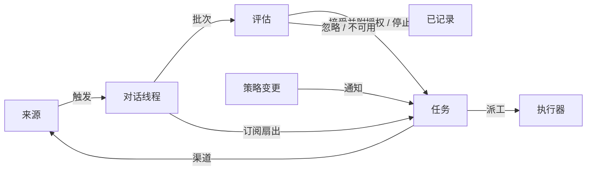

# 001 领域模型

> [English](001-domain.md) | 中文

本文档命名 dsh-superagent 的概念，以及每个概念遵守的规则。代码、智能体调用的工具、面板和其他文档都只使用这些术语，不用别的。遵循 [000 理念](000-philosophy.zh.md)，模型只保留工作所需的概念，一个业务需求会变成其中某个概念的属性。

## 流程

工作从触发（Trigger）流向评估（Eval），再流向执行。来源（Source）产生触发。一个触发会作为上下文扇出到订阅了它所属对话线程的任务（Ticket）。以这种方式到达某个任务的人的消息，留在这个任务上；其他每个触发都进入评估，由评估决定是否请求新的工作。评估接受时，会创建一个带授权（Mandate）的任务。派工（Assignment）把任务交给执行器（Executor），结果通过渠道（Channel）回到来源。

## 概念

来源、对话线程、评估、授权和订阅构成核心领域；其余概念为它们提供支撑。

| 概念 | 定义 | 遵守的规则 | 为什么存在 |
| --- | --- | --- | --- |
| 来源 | 事件的流。来源类型是可复用的实现；来源实例是某个类型的一份配置：是否运行，以及监听什么 | 保存自己的读取位置和自己的机器人身份。定义什么算一个事件，包括只在时间维度上成立的条件。在进入领域之前，丢弃机器人自己的消息，以及它监听范围之外的触发。把每个触发翻译成它所属的对话线程，以及用于回复的渠道地址 | 重启后不能重放事件 |
| 触发 | 带来源自身元数据（例如其发起人）的一个不可变事件 | 属于一个或多个对话线程。同一个触发被接受两次只会创建一个任务 | 审计和幂等的单元 |
| 对话线程 | 按时间排序的触发；由来源决定哪些触发构成同一个对话线程 | 同一时刻最多只有一个评估在它上面运行。它可以有多个任务。它保存自己的订阅、正在运行的评估以及决定历史 | 为评估提供一致的视图和上下文 |
| 关联 | 一个触发所归属的多个对话线程之间的关系 | 只增加上下文，绝不路由 | 让评估能跟进相关证据 |
| 渠道 | 对话线程的写入侧；由来源定义它的地址 | 一个对话线程可以有多个渠道；一个任务持有一组渠道 | 确认回复、回复、拉取请求和已解决的评审都是写入 |
| 策略 | 带版本的评估规则，以及每个来源的那部分：谁能以该来源自己的身份通过该来源发起工作、名单如何同步，以及哪些机器人可以产生候选 | 策略版本涵盖规则、接受模式和来源部分。影响存活任务的变更（例如它所依据的某条规则发生变化）会投递给它的派工；不会撤销授权。不同来源上的身份之间永不互相映射 | 规则变化时，正在运行的评估必须被丢弃 |
| 评估 | 对一批触发的判断，分两层：准入与研判 | 输入：触发批次、对话线程快照、该线程上的所有任务（包括已结束的），以及当前策略。输出：一个决定。不保存状态 | 决定新工作是否开始、继续还是停止 |
| 授权 | 一次接受所授予的内容：策略版本、范围、强度、匹配到的规则、发送者在该来源上的身份，以及来源是如何接收到这个触发的 | 不可变；更宽的范围意味着新建任务。任务结束并不会终止它：只有人的停止会撤回它，而不再持有它的策略会撤销它。已结束的任务在恢复之前，会对照当前策略重新校验 | 说明这项工作为什么可以做，以及可以做到多远 |
| 任务 | 一个被授权的工作单元 | 只有评估能创建任务。任务引用它的授权；持有它的渠道和输入。状态从 open 变为 ended；当人发在它某个对话线程上的消息恢复它时，回到 open，除非是人停止了它。任务定义自己的状态，而不是跟随执行器的状态 | 持有执行过程及其报告 |
| 派工 | 任务与某个执行器实例之间的绑定 | 一个任务在不同时间可以有多份派工。派工独立于任务，从 pending 变为 running，再变为 ended。只有它的最终报告可以在执行器一侧结束任务 | 执行器在领域之外，但“谁在执行”必须在领域之内 |
| 订阅 | 任务与对话线程之间的多对多关系，由对话线程持有 | 匹配的触发会扇出到每个存活的已订阅任务，不检查是谁发出的；以这种方式到达任务的人的消息不经过评估。执行器为获取上下文而关注的对话线程以同样方式到达其任务，但不为任务赋予任何授权，也不会恢复任务。已结束的任务保留它的订阅，包括已关闭或已合并的拉取请求的订阅：人的消息会在同一份授权下恢复该任务，无需评估或决定；来自机器人和 CI 的消息不会到达该任务，因为它的执行器在恢复时会重新读取它的对话线程。被某人停止的任务什么都收不到。主会话只有在消息明确指向某个已存在的任务时，才把对话线程附加到该任务上。人可以移除某个对话线程上的所有订阅；执行器只能移除自己任务对某个它认为无关的对话线程的订阅，但不能移除任务起始所在的那个对话线程，也不能移除来源让它关注的对话线程（例如它的拉取请求所在的对话线程） | 后续讨论无需有人再次提到智能体就能到达执行器 |

人不是领域概念。触发携带其发起人的标识符，形式由来源给出。允许名单是策略中属于某个来源的那部分，使用该来源自己的身份。同一个人在多个来源上都有账号，这是智能体需要时才会读到的提示词文本。

执行器及其会话和目录在领域之外，通过派工连接进来。

聚合：来源持有它的读取位置。对话线程持有它的订阅、正在运行的评估（串行运行，并把期间到达的触发合并进下一批）以及决定历史。任务持有它的派工、渠道和输入，并通过 id 引用决定。

## 被否决的概念

| 被否决的概念 | 原因 |
| --- | --- |
| 把 Principal 或 Membership 当作实体，或跨来源映射身份 | 人是触发元数据；允许名单是策略中属于某个来源的部分；跨来源映射是提示词文本 |
| 由评估调度自己的延迟触发 | 需要等待的条件本身就是一个普通的来源，因此评估永不反过来依赖来源 |
| 等待中或已撤销的评估状态 | 等待属于来源；超时的评估会重新排队它的触发，或以 `unavailable` 结束 |
| 每个对话线程最多一个存活任务 | 一个对话线程可以承载多项独立的工作；研判会依据任务列表避免重复 |
| “追加到任务”的决定 | 追加就是订阅扇出，不需要评估 |
| 在订阅上做准入检查 | 订阅覆盖整个对话线程；授权把授权与上下文分开 |
| 承担路由的关联 | 由订阅负责路由；关联只增加上下文 |
| 跟随 DSH Session 的任务状态 | 任务可以被移交、恢复，或由多个执行器运行，因此它定义自己的状态 |
| 执行器宣称某人要求它停止 | 只有评估能决定结束的强度 |
| 策略变化时取消正在运行的任务 | 被取消的变更会留下半成品；应当记录并投递这次变更 |
| 执行器会话失败或阻塞时锁住它的所有工具 | 这会拒绝在该会话中直接工作的人，也会拒绝恢复之后的报告；暂停自动输入就够了 |
| 从报告的自由文本推断“正在等人” | 分类需要结构化的事实；执行器通过结构化字段来提问 |

## 哪些是可复用的

上面的概念及其规则是可复用的。来源实现、策略内容、执行器和渠道实现属于具体部署。每个来源在内部保留自己的说法，例如 message、chat 或 notification，并把它们翻译成触发。

| 部分 | 本仓库中的情况 |
| --- | --- |
| 来源 | 飞书 Feishu：实时事件、历史回溯、对已订阅主题的轮询。GitHub：通知、已订阅的 Issue 和拉取请求、CI 变化、已合并或已关闭的拉取请求，以及在开启的情况下，仓库中每个新的 Issue、拉取请求和评论，以及默认分支的 CI |
| 策略 | 研判规则，以及每个来源的允许名单、它的同步、它的机器人名单和它的准入表 |
| 执行器 | 一个 DSH 执行器会话，以及每个任务一个目录；位于执行环境中，其变量由执行器和来源注册 |
| 渠道 | 飞书话题回复、GitHub 评论和评审线程回复 |

## 术语表

本表和后续文档所用术语的参考列表，附中文名称；对于上文没有介绍的术语，由后续文档解释。面板一次只显示一种语言；它的 (?) 按钮会用两种语言打开本术语表。智能体发给人的 GitHub 和飞书消息使用平实语言，不使用这些术语。

| 术语 | 中文 | 含义 |
| --- | --- | --- |
| Agent | 智能体 | dsh-superagent 运行的自动化团队成员，通过 GitHub 账号和飞书机器人等身份在各来源上行动 |
| Main Session | 主会话 | 评估触发、接受并派发任务、并做回复的 DSH Session；在代码和提示词中是 `orchestrator` |
| Executor Session | 执行器会话 | 执行器为单个任务运行的 DSH Session；在代码和提示词中是 `worker` |
| Source | 来源 | 事件的流：插件提供的类型，加上一份实例配置 |
| Trigger | 触发 | 来自某个来源的一个不可变事件 |
| Thread | 对话线程 | 按时间排序的触发；同一时刻只运行一个评估的单元 |
| Correlation | 关联 | 共享同一个触发的多个对话线程之间的关系；只增加上下文 |
| Channel | 渠道 | 对话线程的写入侧 |
| Policy | 策略 | 带版本的接受工作规则，以及每个来源的那部分，例如在那里谁可以请求工作 |
| Policy version | 策略版本 | 规则、来源部分和接受模式某一组合的标识符；每份授权都会记录它 |
| Eval | 评估 | 把一批触发变成一个决定的过程 |
| Gate | 准入 | 评估的确定性第一层：谁可以发起工作，以及以什么强度 |
| Assessment | 研判 | 评估过程中模型做出的判断 |
| Decision | 决定 | 评估的结果 |
| Mandate | 授权 | 一次接受所授予的内容：强度、范围，以及它所依据的策略版本 |
| Ticket | 任务 | 一个被授权的工作单元 |
| Assignment | 派工 | 任务与某个执行器实例之间的绑定 |
| Subscription | 订阅 | 任务与对话线程之间的关系 |
| Fan-out | 扇出 | 把已订阅对话线程的触发作为上下文投递给任务 |
| Executor | 执行器 | 运行派工的端口：每个任务一个执行器会话和一个目录 |
| Execution environment | 执行环境 | 执行器会话和准备命令运行的地方：由执行器和来源注册的变量，每个变量都有键、值和描述 |
| Report | 报告 | 派工向其任务报告的状态 |
| Attention | 待人工决定 | 任务上等待人回答的问题 |
| Disposition | 去向 | 某个触发被过滤、被评估或被扇出的记录 |
| Input | 输入 | 投递给任务的上下文：扇出的触发、策略变更、恢复和文本 |
| Scope | 范围 | 授权所允许的工作 |
| Strength | 强度 | 授权或评估的依据有多强 |

| 分组 | 取值 |
| --- | --- |
| Decision | accept 接单 · stop 停止 · ignore 忽略 · unavailable 未完成 |
| Strength | explicit 明确 · inferred 推断 |
| Assignment | pending 待启动 · running 执行中 · ended 已结束 |
| Report | progress 进展 · waiting 等待 · ready 就绪 · blocked 受阻 · failed 失败 · dropped 无需处理 |
