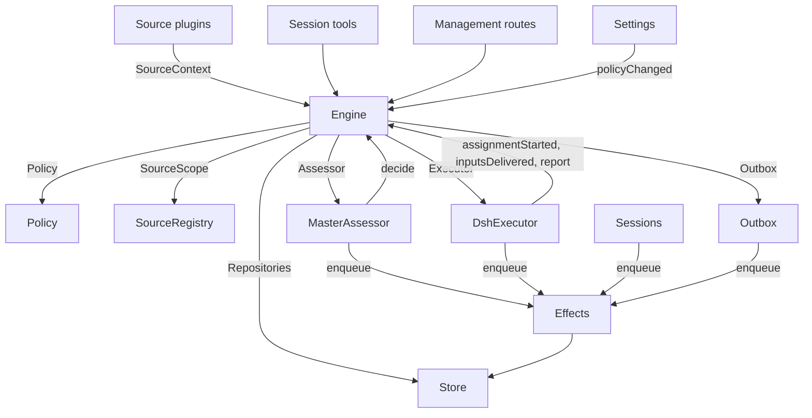

# 007 架构

> [English](007-architecture.md) | 中文

这是实现的开发者指南。它把 [001 领域模型](001-domain.zh.md) 到 [006 部署](006-deployment.zh.md) 中的概念映射到类、接口和文件。先读 Runtime 与 Engine，再把模块表和测试表当作代码索引。

## 核心类与胶合层

核心类在小接口之后拥有领域概念和外部边界。胶合层把工具参数、HTTP 请求、来源负载和 DeepSeek Harness 事件转换成对这些类的调用，再把结果转换成卡片、视图和消息。

`Runtime`（`src/app/runtime.ts`）构造应用、提供依赖，并掌管启动与关闭。`Engine` 构造它自己的内部部件。执行器与 Assessor 会回调 Engine，因此 Runtime 交给它们的是 getter，而不要求按循环顺序构造它们。

### Runtime

`Runtime` 是组合根；它不含任何领域规则。它的构造函数锁定状态目录、打开 Store 并构建每个组件。如果构建失败，它会关闭 Store 并释放锁。

启动时注册管理路由并运行 Setup。setup 解析完成后，安装会话与执行器钩子，确保主会话存在，启动 Policy 同步，恢复被中断的 Assignment，并启动 pass 与 effect。`ready` 标记启动完成。

关闭时取消轮次、等待 pass、effect 与 agent，恢复进程环境，关闭 Store 并释放锁。来源插件通过狭窄的 `SourceHost` 接口把 Runtime 作为 `orchestrator` 服务注入。

| 部件 | 模块 | 作用 |
| --- | --- | --- |
| Setup | `src/app/setup.ts` | 按 worker shell 运行它们的方式探测各 CLI，以此解析仓库与账号；写入并应用 worker 的环境与命令 shim，并保留 setup 问题；Settings 通过它检查变更过的账号，也通过它重启，而重启会再次运行 setup |
| Passes | `src/app/passes.ts` | 一次只跑一轮（pass），每两秒一次，并在任何命令要求时运行：先执行到期的 effect，再执行 `Engine.evaluateDue`；来源的触发经由它到达 Engine |
| Outbox | `src/app/outbox.ts` | Engine 的 `Outbox` 端口，也是回执的唯一写入者：`send` 在一个事务里保存消息的回执并排队它的 `reply` effect，该 effect 的处理器通过 `SourceRegistry.send` 发送它；当来源关闭时消息会等待，当对话已不存在或未被监听时消息被丢弃 |
| Notices | `src/app/notices.ts` | 把领域事件与 worker 活动转换成主会话消息。`eventNotice` 处理领域通知；`reportRelay` 立即转发问题、把普通进度留在其任务上，并转发其他报告；`followupRelay` 指出拥有人工跟进的任务。一轮对话期间到达的转发会在其下一步通过 DeepSeek Harness 收件箱一起投递 |

### Engine

`Engine`（`src/core/engine.ts`）是触发、对话线程、决策、任务与 Assignment 的唯一写入者。它从 `src/core/ports.ts` 接收这些端口：`Repositories`、一个返回当前 Policy 的 getter、`SourceScope`、`Assessor`、`Executor` 与 `Outbox`。可选依赖是 `prepareTicket`、`now` 与 `emit`。

Engine 的所有方法都是同步的。每条命令在一个事务里修改它的聚合。`evaluateDue` 为它改动的每个评估或任务各用一个事务。端口在事务内排队外部工作；适配器在提交之后执行它。无效请求抛出 `UserError`。

Engine 暴露一个入口，并委派给五个内部部件。它拥有每条命令的事务。跨部件的命令（例如 `attach`、`evaluateDue` 与 `policyChanged`）按顺序调用各部件。

每个部件都继承 `EnginePart`（`src/core/part.ts`），后者提供 options 与共享读取。部件之间的依赖单向流动：

| 部件 | 职责 | 依赖 |
| --- | --- | --- |
| `Intake` | 来源的触发：连同其处置只存储一次，记录在其对话线程及其关联（correlation）上，扇出给已订阅的任务；并且，除非它是到达某个任务的人的消息，否则排队到其主对话线程上做评估 | Tickets |
| `Evals` | 对话线程的评估：批处理、闸门的强度、actor 与依据（连同赋予它们强度的触发 `primary`）、从候选投递起算的截止时间及其因暂停产生的顺延、过期评估的重新排队、候选、重放与交回、Policy 变更时的重新排队，以及每个评估最终得到的决策：接受、停止、忽略或不可用 | Tickets |
| `Tickets` | 任务生命周期：从一次接受创建，连同其授权委托、订阅与首个 Assignment；它跟随的对话线程及其关闭（`followsDone`）、被附加的对话线程和为上下文而跟随的对话线程、输入与备注、恢复以及恢复所拒绝的消息、重试、重启、停止与结束、它丢弃的订阅，以及把 Policy 变更通知到受其影响的任务 | Replies |
| `Assignments` | 执行器及其 worker 报告的内容：Assignment 已启动、输入已到达或投递失败、重启中断了它，以及 worker 的报告及其向人提出的问题 | Tickets, Replies |
| `Replies` | 通过 `Outbox` 的渠道写入：确认回复、答复、结果与提醒消息，每一种都按允许它的规则发送 | 无 |

命令使用祈使式名称，例如 `stopTicket`；适配器上报的事实使用过去式名称，例如 `assignmentStarted`。查询 `candidate` 使用名词。

调用者只拿到自己角色所需的 Engine 的 `Pick`：`EngineForSources`、`EngineForMainSession`、`EngineForPeople`、`EngineForSettings` 或 `EngineForExecutor`。

| 角色 | 方法 | 效果 |
| --- | --- | --- |
| Sources | `receive(trigger)` | 一次存储一个触发，并回答 `stored`、`duplicate`，或在没有来源接收它时回答 `filtered`；把它扇出给订阅了它所在对话线程的任务——其中，人的消息会立即恢复一个已结束的任务，除非处理已暂停——并把它排队到其主对话线程上做评估，除非它是已到达某个任务的人的消息，此时它仍归该任务 |
| Sources | `bindThread(ticketId, thread, own)` | 让未结束的任务跟随来源的某个对话线程，例如某个 pull request 的对话线程；若该任务开启了它，则 `own` 为真；再次绑定的已关闭对话线程会重新打开。结束任务的是对话线程的关闭，而不是 `ready` 报告 |
| Sources | `threadClosed(thread, outcome, at)` | 一个对话线程关闭：每个跟随它的未结束任务记录该关闭，并在它对自己跟随的对话线程处理完毕时结束（`followsDone`）：它开启的对话线程都不再打开，或者，当它没有开启任何对话线程时，它跟随的每个对话线程都已关闭。它按这些关闭中最新的那个以 `merged` 或 `closed` 结束，除非关闭之后恢复的工作尚未报告 `ready`，或者它的执行器已经通过确认回复或答复，接管了某个人在其最新一次报告（`progress` 之外）之后、或在其最后一轮结束之后才判定的人的跟进；此时 `dropped` 报告会像那次关闭一样结束它 |
| Main Session | `candidate(triggerId)` | 持有某个触发的评估，即以评估者视角看到的它 |
| Main Session | `candidateDelivered(evalId)` | 评估的候选到达主会话：其截止时间从此刻起算 |
| Main Session | `decide(triggerId, outcome)` | 记录一个评估决策，或对显式请求记录一个直接决策。接受会原子地创建任务、授权委托、Assignment、订阅与确认回复。从卡片上忽略的推断候选，会在所给原因之前记录 `ignoredFromCard`。当 `followupOwners` 仍拥有某个人工跟进时，只允许 stop |
| Main Session | `attach(ticketId, triggerId, note?)` | 把触发路由到它所指向的任务，由该任务的执行器将其判定为跟进，并结束持有它的评估，该评估的其他触发等待新的评估；已结束的任务会立即在其授权委托下恢复，除非处理已暂停。执行器仍在判定的跟进会被拒绝，被路由回交回它的那个任务的跟进也会被拒绝 |
| Main Session | `requestStatus(ticketId)` | 向正在等待的执行器会话询问其状态，并回答是否询问了 |
| Main Session | `note(ticketId, text)` | 把来自其他工作的事实作为文本输入交给任务的执行器，这不授予任何权限 |
| Main Session, Executor | `reply(request)` | 为其用途所指的渠道排队一条消息：`acknowledgement`、`answer`、`result` 或 `attention` |
| People | `stopTicket(ticketId, reason?)` | 人的停止，会撤回授权委托 |
| People | `retryTicket(ticketId)` | 结束某个任务停滞的 Assignment——该任务在 `failed` 或 `blocked` 报告之后等待一个人，或其输入投递失败（`canRetry`）——并启动一个新的 |
| People | `reevaluate(triggerId)` | 把已存储的触发排队以获得新的评估 |
| People | `unsubscribe(thread)` | 丢弃某对话线程上的所有订阅，跟随它的任务不再跟随它；每个任务仍继续判定它在那里收到的跟进 |
| People | `dismiss(decisionId)` | 关闭（dismiss）`unavailable` 决策所显示的问题，该问题由该决策记录 |
| Executor | `assignmentStarted(ticketId, assignmentId)` | 一个 Assignment 开始运行；它等待中的输入被发出 |
| Executor | `inputsDelivered(ticketId, assignmentId, inputIds)` | 输入到达该 Assignment 的执行器会话，在那里每一个都等待某一步来取走它 |
| Executor | `inputsRead(ticketId, inputIds)` | 执行器会话把携带这些输入的消息纳入其历史（一个 `user/message` 会话事件），模型由此获得它们；此前领取过它们、却被取消或失败的步骤不算。一次报告或一轮结束随后到来即算已读，重启之后亦然，而其任务的结束也不会让它作废；在读取被记录之前投递的输入，在其投递之后有一次报告或一轮结束即算已读 |
| Executor | `turnEnded(ticketId, assignmentId)` | 执行器会话的一轮结束——在一次报告之后，也在它后台已无任何事情运行、或它把工作交接给人时发生。它在某一步之前取走的内容，即已读取（`inputsRead`） |
| Executor | `deliveryFailed(ticketId, assignmentId, error)` | 输入投递失败；任务会显示该问题，直到某次投递成功、新的 Assignment 开始或任务结束 |
| Executor | `report(ticketId, report)` | 记录一份报告及其向人提出的问题；`dropped` 结束任务，`ready` 完成一个不跟随任何对话线程的任务，并按对话线程结束的方式结束一个已处理完其所跟随对话线程的任务 |
| Executor | `markUnrelated(ticketId, thread, reason)` | 只丢弃该任务对某个被附加对话线程的订阅（它认为两者无关），并连同原因交回该任务在那里判定的跟进 |
| Executor | `followForContext(ticketId, thread)` | 让未结束的任务为上下文订阅相关对话线程：其消息会到达任务，但不赋予它跟进强度，也不会恢复它 |
| Executor | `handback(ticketId, triggerId, reason)` | 记录该任务交回一个到达它的触发，附上其候选所携带的原因，并在没有其他任务判定它时（若本任务判定过它）将其排队以获得新的评估；它回答是否排入了队列。一个任务对每个触发只交回一次，并保留其订阅 |
| Executor | `assignmentInterrupted(ticketId, assignmentId)` | 主机停止时有 Assignment 正在运行：工作中途被中断的，或在其最新报告之后收到输入的，会带着恢复说明和已投递给它、但其执行器会话未取走的输入重新开始，如同一次重试；自那以后已报告过的则保留其会话。DshExecutor 在启动时按最旧任务优先逐个上报（`resume`），并重新排队那些等待中的启动 |
| Passes | `evaluateDue()` | 除非处理已暂停：为那些排队的触发仍在等待的对话线程启动评估，每个对话线程一次，其间排队的触发作为一个批次；把已过截止时间的评估的触发再次排队，连续两次，第三次记录为 `unavailable`；并恢复那些在暂停期间收到人的消息的已结束任务，前提是其授权委托仍然有效。候选尚未到达主会话的评估不会过期。处理暂停期间没有评估会过期，一旦恢复，每个截止时间都会向后顺延暂停的时长 |
| Settings | `policyChanged(from, to, effects)` | 告诉每个受影响的活动任务，该变更以何种方式影响它（`src/policy.ts` 中的 `policyEffects`：它被接受时所依据的规则已改变或不再适用、其请求者可能不再能发起工作，或主动工作不再被接受），并按新版本重启进行中的评估 |

Engine 把批处理、授权、扇出、恢复与提醒（attention）生命周期规则保持为私有。若干共享谓词让这些规则保持一致：

- `waitsForPerson`（`src/core/model.ts`）：最新的 Assignment 报告了 `blocked` 或 `failed`，且此后没有人的消息到达。只要它为真，自动输入与被判失败的启动就保持搁置。
- `followupOwners`：仍对自己对话线程上收到的人工跟进负责的任务。任务可以是活动的，也可以是在没有人工停止的情况下已结束、正等待恢复的。交回该消息会结束这种所有权。
- `settled`：某个决策已解决了该请求；stop、unavailable、routed 与 refused-stop 决策不算。
- `ticketStage`（`src/core/stage.ts`）：实现 [003 执行](003-execution.zh.md) 中的阶段表。

当任务结束时，未读的跟进会回到评估，除非还有其他任务拥有它们，或另一处置已了结它们。已确认回复、已答复和已交回的消息不在其列。对于没有确认回复处置的旧记录，由 outbox 回执提供这一事实。最终报告也覆盖 Assignment 开始时正在等待的消息，包括恢复它的那条消息。停止任务的那条消息不会被自动重新评估。

在一次变更之后，Engine 从 `src/core/ports.ts` 的 `DomainEvents` 发出一个事件：

`trigger.received`、`eval.started`、`decision.recorded`、`ticket.created`、`ticket.resumed`、`ticket.ended`、`assignment.started`、`assignment.ended`、`thread.subscribed`、`thread.unsubscribed`、`trigger.requeued` 或 `policy.changed`。

Runtime 把 `ticket.ended`、`trigger.requeued` 与 `thread.unsubscribed` 转换成通知。投递给任务的属于人的 `trigger.received` 会变成一次跟进转发。当任务以 merged 或 closed 结束时，`pullEndNotices` 使用稳定 id 发送一条聊天通知。其他事件目前没有消费者。

### 模型

`src/core/model.ts` 保存领域类型，`src/core/stage.ts` 保存任务阶段。决策把原因记录为 `reason`，即一组 `Reason`（`src/core/reasons.ts`）：每个都是一个 `code`，带其 `values`，而对于批次中的一个触发，还带其 `triggerId`。

核心的代码（例如 `timeout`、`policyChanged`、`routed` 与 `startedTicket`）属于 `REASONS`，其中带有 agent 通过 `reasonText` 读取的英文；闸门或来源作用域给出自己的代码，例如 `not_a_member`；`said` 则携带评估者或人写下的话。面板用 `reason.<code>` 为每个代码配词，被来源过滤的触发也以同样方式记录来源的代码。

任务对每个事实只保留一份。只要它没有 `ended` 就是未结束的，该字段记录它在何时、由谁、因何、以何种结果结束；它最后说的话是其最新的 Assignment 报告（`latestReport`）；它的执行器会话以它命名（`src/executor/dsh.ts` 中的 `workerSessionId`）。

它的字段都是有类型的：`origin`，即赋予其评估批次强度的可准入触发以及该批次本身（`triggerId`、`triggerIds`）；`execution`，执行器选择的内容（`name`、`directory` 与 `assignment`）；`delivery`，最后一次失败的输入投递（`error`、`at`），直到某次投递成功、新的 Assignment 开始或任务结束为止；以及 `follows`，来源让它跟随的对话线程，每个形如 `{thread, own, closed?}`：任务开启它时 `own` 为真，关闭之后 `closed` 带有 `at` 与 `outcome`。只有 Tickets 会写 `follows`；GitHub 来源用 `pullsOf` 与 `pullOf` 读取它的 pull request（`src/sources/github-pull.ts`）。

携带触发的输入会记录它是否由人写下，`waitsForPerson` 会读这一点。对话线程还在 `context` 中列出仅为上下文而跟随它的已订阅任务，并在 `expired` 中计数其排队触发的评估连续过期的次数；评估记录其 `primary` 触发以及其候选何时 `delivered`。

触发的处置记录它到达的任务（通过扇出或附加）、人的一次重新排队、每个交回它的任务及其原因，以及每个其执行器确认回复或答复了它的任务。

授权委托的 `basis`（`MandateBasis`）记录闸门如何准入它的触发。重新校验会读取接收方的 `source`、`scope` 与 `row`、所列的 `sender`、匹配的 `rules` 以及 `via`：

| `via` | 准入依据 |
| --- | --- |
| `addressed` | 一个被允许的发送者点名了 agent |
| `followup` | 一条消息到达了带有任务的对话线程 |
| `admission` | 准入表的一个单元格；`observation` 标记一个推断出的候选 |
| `bot` | 一个所列的 bot 产生了一个推断出的候选 |

触发与对话线程的 `meta` 属于来源。核心不解释它们。

### 策略

`src/policy.ts` 定义设置 schema、授权与评估规则。`settingsPolicy(settings, scope)` 每次使用时返回一个新的、无状态的 `Policy`：

- `version`、`paused` 与 `evalTimeoutMs` 描述它的当前状态。
- `gate(trigger, thread, tickets)` 返回准入强度与依据。
- `revalidate(mandate)` 检查既有授权委托是否仍然成立。
- `admitsInferred(rules)` 仅在自动模式且存在已启用的匹配规则时允许主动接受。

`assessmentOutcome(assessment, settings, strength)` 把模型的评估转换成 Engine 的结果。它要求对每条已启用的规则都有判断、方向已定、有匹配的规则，以及意图的证据。在自动模式之外，推断出的接受会变成一条“将会接受”的记录。

`policyEffects(tickets, old, now, scope)` 识别一次变更影响哪些未结束任务以及如何影响。`Engine.policyChanged` 只通知这些任务。`policyVersion` 对规则、接受模式以及各来源的 Policy 部分（包括 bot 列表）做哈希。

### Store

`Store`（`src/app/store.ts`）拥有一个 SQLite 数据库。Runtime 在打开它之前先获取目录锁，防止第二个进程迁移或写入同一份状态。

它的接口按用途分组：

- **领域仓库：**`atomic`，以及 `triggers`、`threads`、`tickets` 与 `decisions`，各自都有 `get`、`save` 与列表查询。被索引的工作集是 `threads.active()`、`tickets.open()`、`tickets.active()` 与 `read.subscribedThreads`。
- **读查询：**`read` 通过 `threadTriggers`、`triggerStats`、`search` 与 `droppedReplies` 之类的方法为视图、工具与来源轮询服务。这些方法从不写入。
- **来源元数据：**`threads.describe` 与 `threads.patchMeta` 更新来源拥有的对话线程元数据。
- **设置：**`settings`、`saveSettings`、`blockRevision` 与 `settingsHistory`。设置与 prompt 使用带编号的 `Versions`（`src/app/versions.ts`）。
- **Outbox 回执：**`replyStatus` 与 `receipts`，只由 Outbox 写入。回执操作是 `get`、`waiting`、`behind`、`add`、`settle` 与 `withdraw`。`behind` 检查同一任务与同一对话的较早消息是否在等待，且失败次数少于三次。被撤回的消息以 `channelGone` 或 `channelIgnored` 了结。读查询通过 `failingReplies`、`droppedReplies` 与 `droppedSince` 暴露失败与被丢弃的回复。
- **带类型的键值记录：**`get`、`set`、`delete` 与 `keys`，使用 `KV` 中的条目。

`afterCommit` 只在事务提交之后运行一个动作，绝不在回滚之后。Runtime 按存储的形态读取记录；schema 11 迁移在启动时转换较旧的受支持记录。

### Effects

`Effects`（`src/app/effects.ts`）是持久化的副作用队列。命令在其事务内调用 `enqueue(kind, key, payload)`；执行只在提交之后开始。

每个 kind/key 对占一行。排队同一个等待中的 key 会替换其 payload 并使其立即到期，但不改变队列顺序。`handle(kind, run, options)` 为每个 kind 注册一个处理器。它按最旧优先处理到期的行，直到并发上限。

失败会以指数退避重试。抛出 `Later` 会推迟工作且不计为失败，例如没有可用的 worker 槽位时。`start` 在 setup 之后开始处理，`drain` 在关闭期间停止处理并保留待处理的行，`pending`/`idle` 暴露队列状态。

| Kind | 处理器 | 作用 | 并发 | 重试 |
| --- | --- | --- | --- | --- |
| `assessment` | MasterAssessor | 把评估的候选卡片引导进主会话的轮次，然后告诉 Engine 它已投递，从而启动该评估的截止时间 | 4，暂停时无 | 2 秒起，每次翻倍至 60 秒 |
| `launch` | DshExecutor | 启动一个待处理的 Assignment：prepare 命令、执行器会话、assignment 消息 | 空闲的 worker 槽位，暂停时无 | 模型提供方或网络的一次瞬时失败会在 5 秒后重试，每次翻倍至 300 秒，共三次；任何其他失败，以及失败的 prepare 命令，都会使其任务失败。因暂停或 worker 槽位已满而搁置的，会在 5 秒后重试 |
| `delivery` | DshExecutor | 按顺序把任务等待中的输入交给它正在运行的 Assignment | 4，暂停时无 | 2 秒起，每次翻倍至 60 秒；等待 worker 槽位的会在 2 秒后重试 |
| `relay` | Sessions | 把 worker 的报告或问题，或人的一次跟进，引导进主会话的轮次 | 1，按队列顺序 | 2 秒起，每次翻倍至 60 秒 |
| `notice` | Sessions | 向主会话注入一条通知而不唤醒它 | 1，按队列顺序 | 2 秒起，每次翻倍至 60 秒 |
| `reply` | Outbox | 通过其来源为其渠道发送一条消息，且要在其任务发往该对话的较早消息之后（这些消息尚未失败三次）；撤回该消息会取消它 | 1，暂停时无 | 5 秒起，每次翻倍至 300 秒；来源关闭或排在较早消息之后的，会在 5 秒后重试 |

每个 kind 在其名称下有一条健康条目。当它的某个 effect 连续失败三次时，该条目上报错误，但 `delivery` 除外——它的失败显示在其任务上。转发保持顺序，通知也一样；某个失败会挡住同 kind 的后续项。

### 来源

来源通过 `SourceKind` 扩展宿主，定义在 `src/sources/kind.ts`。一个 kind 声明其身份、标题、描述、配置 `schema` 与 `fields`、派生的 `facts`，以及 `health` 条目。可选行为包括 `scope`、`channel`（`allowed`、`send`、`link`）、`threadContext`、`find`、`policy`、`environment` 与 `refreshLabels`。

`SourceRegistry`（`registry.ts`）拥有已注册的 kind 与已存储的实例，并实现 Engine 的 `SourceScope`。注册会在 `HealthBoard` 上认领健康条目；重复认领与保留的 `sync:` 名称会被拒绝。`SourceContext` 只通过其注册所认领的条目写入，因此注销之后的报告什么也不做。

Registry 的配置方法包括 `kind`、`instances`、`instance`、`validate`、`validatePolicy`、`policyPart`、`channelAllowed`、`declarations`、`environments`、`find` 与 `scope`。`find` 询问每个支持搜索的 kind。

通用代码通过 registry 访问来源行为。`send(message, commands)` 调用 kind 的 Channel，并返回 `sent`、`gone`，或在 kind 未安装时返回 `waiting`。`link` 解析其 Channel 链接。`threadContext` 把 kind 的读取器与其配置配对，或在该 kind 没有读取器时返回空。无效的存储配置会禁用该实例。

插件接收 `SourceHost`：registry 与 `context(kind)`。kind 自身使用更狭窄的 `SourceContext`，由 `src/app/source-context.ts` 中的 `sourceContextOf` 构建。

该上下文提供部署与命令、setup 就绪状态（`ready`、`configured`、`problem`）、配置、`receive`、`atomic` 与带类型的 `state`。它还暴露对话线程读取与元数据写入、任务读取与绑定/关闭命令、触发读取、通过 Outbox 的 `notify`，以及针对已声明健康条目的 `report`。

### DshExecutor

`DshExecutor`（`src/executor/dsh.ts`）为每个任务提供一个会话与一个目录。`start` 与 `deliver` 排队 `launch` 与 `delivery` effect。`stop` 通过 `Store.afterCommit` 取消轮次，因此被回滚的结束不会停止 worker。

`prepare(ticket, outcome)` 提供 Engine 的 `prepareTicket` 钩子：短名、目录与 `ticketExecution` assignment 文本。`workerSessionId(ticket.id)` 派生会话 id。

`WorkerSlots` 在启动或唤醒空闲 worker 的投递之前预留容量。人的消息可以使用超出 `maxWorkers` 的一个槽位，唤醒优先于启动。`activeCount` 提供面板的负载。

提供方与网络的瞬时失败获得三次重试。启动使用 effect 退避；失败的轮次在 15、30 与 60 秒后收到续接消息。`inputMessage` 依据当前任务状态渲染每个输入，`mandateInstructions` 为推断出的工作加上匹配规则的限制。

`install` 订阅会话事件；`dispose` 取消订阅。轮次结束通常报告为等待，但就绪之后或需要人工操作时除外。错误报告为 failed。启动时，`resume` 通过 `assignmentInterrupted` 上报被中断的 Assignment，并重新排队那些不等待人的待处理启动，最旧任务优先。

### MasterAssessor

`MasterAssessor`（`src/app/assessment.ts`）让主会话评估主动候选。`request` 排队一个评估 effect；`release` 在其评估结束时丢弃缓存状态。

它的 `context`、`read` 与 `decide` 方法服务于 `orchestrator_eval`、`orchestrator_eval_read` 与 `orchestrator_eval_decide`。它们通过 `SourceRegistry.threadContext` 提供有界的对话线程上下文、仓库上下文，以及决策提交。没有上下文读取器的 kind 只提供触发与批次。

`assessmentOutcome` 为 `Engine.decide` 转换模型的回答。Evals 会再次依据当前 Policy 检查推断出的接受。

### Settings

`Settings`（`src/app/settings.ts`）读写带修订号的设置块。`current` 与 `view` 读取它们；`save(block, value, revision, origin)` 校验一次保存；`pause(paused, origin)` 修改单独的 `paused` 设置。

每次保存都声明其来源：`panel`、`tool` 或 `sync`。只有 `panel` 可以修改执行环境或 `SETUP_FIELDS`（`src/deployment.ts`）中列出的字段。

Policy 版本变更会计算 `policyEffects`、记录通知了哪些任务，并调用 `Engine.policyChanged`。`syncable` 与 `sync(id)` 刷新某个来源的 Policy 部分。`refreshLabels(id)` 刷新显示名称。

### Prompts

`Prompts`（`src/app/prompts.ts`）把配置存为 `Versions`。`current`、`version` 与 `history` 读取它们；`validate`、`preview` 与 `save(value, baseRevision, source)` 检查并保存它们。`compose` 与 `skills` 构建会话文本。

`builtInParts` 列出覆盖键、角色、默认文本与必需的模板占位符。每个覆盖都存储团队 `text` 与一个 `base`：其原始默认值的 `builtInBase` 键。保存会在 `KV.prompts.builtIn` 下保留该默认值。`defaultChanged` 随后上报已变更的默认值、其旧文本（若可用）以及被移除的部分。

校验会从已保存的覆盖继承被省略的 base，丢弃已存在于保存数据中的被移除部分，并拒绝空白文本或其他未知键。这使保存工具能够对它读到的配置做往返。`environmentSection` 与 `policySection` 只用自有键替换一次模板值。没有覆盖的配置使用默认值。

### Sessions

`Sessions`（`src/app/sessions.ts`）为两种角色管理 DeepSeek Harness 会话。`ensure` 用其角色的模型创建会话。`install` 跟踪 agent 事件，并为受管会话注册 prompt、skill 与工具。

`prompt` 每个 request id 只投递一次。`relay` 与 `notify` 排队由 `relay` 与 `notice` effect 处理的主会话消息。`src/app/notices.ts` 定义它们的内容；`delivery` 检查消息是否到达。

每次模型请求都会把会话绑定到当前的 prompt 修订。它使用过的修订会被持久保存：`promptVersion` 标识活动的那一个，`mayRead` 限制 worker 可以查看哪些版本。注册按每个 agent 一张映射跟踪。

`status` 与 `promptVersion` 为 prompt 页面服务。保存经由 `Prompts.save` 并通知主会话。`modelRetry` 暴露模型预算的重试状态。

### 胶合层

| 胶合层 | 转换 |
| --- | --- |
| `src/app/runtime.ts` | 组合根：用各部分所用的接口构建它们，注册路由与 Source host，并启动、停止 dsh-superagent |
| `src/app/notices.ts` | 把领域事件与 worker 报告转换成主会话的通知与转发 |
| `src/app/tools/main.ts`、`src/app/tools/executor.ts` | 把主会话与执行器会话的工具参数转换成对核心类的调用，并把结果转换成卡片 |
| `src/app/http.ts`、`src/app/views/`、`src/app/api.ts` | 把 HTTP 请求转换成调用，把 Store 读取转换成面板的视图；`api.ts` 为面板标注每条路由的类型 |
| `src/app/resources.ts`、`src/app/links.ts`、`src/app/cards.ts` | 把资源名转换成读取，把来源消息转换成链接，把记录转换成给模型的紧凑卡片 |
| `src/sources/github*.ts`、`src/sources/feishu*.ts`、`src/sources/poll.ts` | 把 GitHub 与 Feishu 负载转换成触发与对话线程事实，把消息转换成 CLI 调用 |
| `src/deployment.ts`、`src/setup.ts`、`src/infra/` | setup 探测与问题、CLI 传输、agent 的进程环境 |

## 依赖规则

- **显式、狭窄的依赖。**每个类接收一个接口，接口点名它所用的东西，大多是其他类的 `Pick` 类型：核心类的 `ExecutorHost`、`AssessorHost`、`SessionsHost`、`SettingsHost`、`SetupHost`、`PassesHost` 与 `OutboxHost`，胶合层的 `HttpHost`、`MainToolsHost`、`ExecutorToolsHost`、`ResourceHost`、`LinkHost` 与 `SourceContextDeps`，而 Engine 则是调用它的那个角色的 `Pick`。Runtime 只在此类接口之后传递自身。来源插件注入 `orchestrator` 服务，其类型把它命名为 `SourceHost`：registry 与 `context(kind)`；其 kind 的代码只看到自己的 `SourceContext`。
- **谁可以导入谁。**`src/core` 除 Node 的哈希之外不导入自身之外的任何东西，也不做 I/O。`src/sources` 不从 `src/app` 导入任何东西。面板只从宿主侧导入类型，以及 `src/admission.ts`、`src/limits.ts`、`src/setup.ts`、`src/navigation.ts`、`src/sources/host.ts`、`src/core/errors.ts`、`src/core/reasons.ts` 的普通值与 `src/app/api.ts` 的过滤列表。
- **每种状态只有一个写入者。**每种状态都有一个写入者，其他部分读取它或询问该写入者。

  | 状态 | 写入者 |
  | --- | --- |
  | 触发、对话线程、决策、任务、Assignment | Engine |
  | 来源的读取位置，以及它在其对话线程上保留的 meta（`label`、`url`、`facts` 及其自有键） | 该来源，通过 `SourceContext` |
  | 设置及其历史 | Settings |
  | Prompt 版本 | Prompts |
  | Effect 行 | Effects |
  | Outbox 回执 | Outbox：Engine 的消息与来源的 `notify` 都经由它的 `send`，其 `reply` effect 标记它们 |
  | 一个健康条目 | 在 `HealthBoard`（`src/infra/health.ts`）上认领它的部件，该处拒绝第二次认领：`runtime` 由 Runtime 认领，Passes 通过它上报；`evals` 由 Runtime 在每轮之后认领；`models` 由 Sessions 认领；每个 effect kind 由 Effects 认领；`worker` 由 DshExecutor 认领；某个来源 kind 的条目由 SourceRegistry 为该 kind 的来源认领；`sync:<id>` 由 Settings 认领 |

  来源只通过 `SourceContext.tickets.bindThread` 与 `threadClosed` 修改任务，而它们会调用 Engine。
- **请求与事实。**请求某物的方法用祈使动词加其对象命名，例如 `stopTicket` 或 `bindThread`，并且可以被拒绝；记录适配器所做之事的方法用过去式命名，例如 `assignmentStarted` 或 `deliveryFailed`。每个宿主按它需要的角色类型接收 Engine。
- **带类型的字段，来源数据放在来源下。**代码读取任务与授权委托的带类型字段。来源不在任务上保留任何东西：任务跟随它的哪些对话线程，就是任务的 `follows`；它关于某个触发或对话线程保留的内容，就在它们的 `meta` 中。
- **固定的拒绝。**人或者 agent 能造成的拒绝，是来自 `src/core/errors.ts` 中 `USER_ERRORS` 的 `UserError(code, values)`。管理 API 对 `missing` 代码返回 404，对其他代码返回 400，面板用其语言为每个代码配词。setup 问题是 `SetupError` 代码（`src/setup.ts`），固定的健康文本是 `HealthCode`（`src/sources/host.ts`），配词方式相同。
### 来源特有的依赖

`link` 与 `textLimit` 能力已把其中两项移出通用模块；其余仍直接引用 GitHub 或 Feishu：

- `src/app/resources.ts` 读取 `feishu/` 与 `github/` 的原始记录；`src/app/cards.ts` 为任务卡片使用 `pullOf`。
- Runtime 为已 merged 或 closed 的任务发送 `pullEndNotices`。
- 执行器工具用 `readPull` 与 `claimPull` 绑定所报告的 pull request，使用 Runtime 暴露的 GitHub 上下文。
- MasterAssessor 用 `readRepositoryPath` 读取仓库文件。
- Sessions 与 Prompts 只为 GitHub 与 Feishu 注册内置 skill。迁移会转换它们的 schema-10 记录。
- Setup 只探测 GitHub 与 Feishu 的账号字段（`SETUP_FIELDS`）。只有这些来源通过 `SourceContext.problem` 接收账号 setup 问题。

`src/plugin/index.ts` 是第三方来源 kind 的公开 SDK；`link`、`textLimit`、`ingress` 与 `resource` 在那里是可选能力，因此 kind 可以提供它们而无需应用点名它。其余各点将在后续阶段迁移到同一能力模型。

## 模块

| 路径 | 职责 |
| --- | --- |
| `src/index.ts` | 主插件入口：读取机器设置，启动 Runtime，并交给它保存来源账号时所用的重启 |
| `src/plugin/index.ts` | 公开的来源插件 SDK，以 `dsh-superagent/source-kit` 发布：`SourceKind`、宿主与上下文契约、可选能力（`link`、`textLimit`、`ingress`、`resource`），以及来源需要的命令、KV、健康、文本与 id 辅助函数。它再导出契约；`src/sources/*` 保持内部 |
| `src/deployment.ts` | 插件的 `Config` 与 `Machine`；`resolveDeployment` 与 `resolveFeishuBot` 从来源设置中读取仓库与账号，每个 CLI 都按执行器 shell 运行它的方式运行；`SETUP_FIELDS` 列出 setup 读取的来源字段。代码不指名任何个人、账号或组织 |
| `src/setup.ts` | setup 问题：`SetupError`，带一个代码、修复它的位置，以及日志、主会话与面板共享的英文文本 |
| `src/policy.ts` | Policy：按块划分的设置 schema、Policy 版本、闸门与授权委托的重新校验 |
| `src/admission.ts` | 准入表的值、每个单元格的选项与默认值，与面板共享 |
| `src/limits.ts` | 人可以设置的值的限制，设置 schema 会检查它们，面板的字段会提供它们 |
| `src/kv.ts` | `KV`：每个 `kv` 记录族及其键、值类型与所有者，以及 Store 与 `SourceContext.state` 所接受的 `Key` 与 `Family` 类型 |
| `src/navigation.ts` | 当宿主的目录列出某个 DeepSeek Harness 会话后，从面板打开它 |
| `src/core/model.ts` | 领域类型，其中包括带类型的任务与 `MandateBasis`，以及 `threadKey`、`ticketOutcome`、`reached`、`followupOwners`、`settled`、`waitsForPerson`、`liveTicket`、`runningAssignment`、`latestAssignment` 与 `latestReport` |
| `src/core/ports.ts` | 端口：`Repositories`、`Policy`、`SourceScope`、`Assessor`、`Executor`、`Outbox`，以及领域事件 |
| `src/core/engine.ts` | Engine，核心的入口，以及角色接口 `EngineForSources`、`EngineForMainSession`、`EngineForPeople`、`EngineForSettings` 与 `EngineForExecutor` |
| `src/core/part.ts` | `EnginePart`，Engine 各部件的基类，以及 `EngineOptions` |
| `src/core/intake.ts` | `Intake`：来源的触发，流向它们的任务，并且——除非人的消息已到达某个任务——流向评估 |
| `src/core/evals.ts` | `Evals`：对话线程的评估及其决策 |
| `src/core/tickets.ts` | `Tickets`：任务生命周期、任务跟随的对话线程、订阅与输入 |
| `src/core/assignments.ts` | `Assignments`：执行器的事实及其 worker 的报告 |
| `src/core/replies.ts` | `Replies`：Engine 的渠道写入 |
| `src/core/stage.ts` | `ticketStage` 与 `canRetry`：[003 执行](003-execution.zh.md) 中的任务阶段 |
| `src/core/errors.ts` | `UserError` 与 `USER_ERRORS` |
| `src/core/reasons.ts` | `Reason`、`REASONS` 与 `reasonText`：核心记录一个决策或搁置一个触发的理由，按代码给出 |
| `src/core/ids.ts` | `key`：由输入派生的 id，输入相同则 id 相同 |
| `src/core/memory.ts` | `MemoryRepositories`：内存中的 Store 仓库，保持 Store 的顺序及其嵌套回滚，用于领域测试 |
| `src/core/index.ts` | 核心的导出 |
| `src/app/runtime.ts` | Runtime，组合根，及其启动与停止 |
| `src/app/setup.ts` | Setup，以及 `setupChanged`：一次保存是否修改了 setup 读取的字段 |
| `src/app/passes.ts` | Passes，轮次调度器 |
| `src/app/outbox.ts` | Outbox：Engine 的 `Outbox` 端口、回执，以及发送它们的 `reply` effect |
| `src/app/notices.ts` | 主会话的通知与转发：`eventNotice`、`reportRelay`、`resultRelay` 与 `followupRelay` |
| `src/app/store.ts` | Store，以及 `Receipt`，即 outbox 的一条消息 |
| `src/app/store-read.ts` | `storeReads`：Store 为视图、工具与来源轮询提供的读查询，它们从不写入 |
| `src/app/migration.ts` | schema 11 迁移：从 schema 10 一步完成，按当前形态写入每条已存储记录 |
| `src/app/effects.ts` | Effects |
| `src/app/versions.ts` | `Versions`：以带编号的快照加指向当前快照的指针保留的记录，用于设置与 prompt |
| `src/app/cache.ts` | `TextCache`：在内存中按大小上限保留的文本，最先丢弃最久未用的 |
| `src/app/settings.ts` | Settings |
| `src/app/settings-history.ts` | `policyHistory`：每个已保存的设置修订及其相对上一修订的改动 |
| `src/app/prompts.ts` | Prompts、`builtInParts`（团队可以覆盖的内置部分），以及 `promptParts`（某个角色 prompt 各节的顺序） |
| `src/app/context.ts` | 内置 prompt 文本（从 `prompts/` 读取），以及会话读取的转录条目 |
| `src/app/skill-files.ts` | 打包的文本：`promptFile`（把文件中每行一句的文本合并成段落）与随包的 skill |
| `src/app/sessions.ts` | Sessions |
| `src/app/delivery.ts` | `AgentDelivery`：向 DeepSeek Harness agent 投递消息，每个 request id 一次，被恢复的会话亦然 |
| `src/app/retry-health.ts` | `RetryHealth`：哪些会话在等待模型预算重试，供 `models` 健康条目使用 |
| `src/app/role-models.ts` | 解析评估与执行器所用的模型，并用其角色的模型初始化新会话 |
| `src/app/assessment.ts` | MasterAssessor、评估 schema，以及 `orchestrator_eval` 所回答的窗口 |
| `src/app/execution-environment.ts` | 执行环境：它的变量、任务的值、目录根，以及 prompt 各节的行，`src/app/prompts.ts` 会把它们填入其模板 |
| `src/app/source-context.ts` | `sourceContextOf`：每个来源 kind 的 `SourceContext` |
| `src/app/links.ts` | `sourceLink`（触发消息的页面）与 `candidateCard` |
| `src/app/cards.ts` | 给模型的触发、任务、对话线程与决策紧凑卡片、任务卡片状态的封闭集合 `TICKET_STATES`，以及 `textPage` |
| `src/app/resources.ts` | `RESOURCES` 与 `readResource`：`orchestrator_read` 为每个角色读取的内容 |
| `src/app/tools/tool.ts` | `Tool` 类型、`readTool`、两种角色的 `orchestrator_read`，以及 `AcknowledgementSchema` |
| `src/app/tools/main.ts` | 主会话的工具 |
| `src/app/tools/executor.ts` | 执行器会话的工具 |
| `src/app/http.ts` | `/orchestrator/api` 路由：同源检查、请求限制，以及每类失败一个状态码 |
| `src/app/api.ts` | `Api`：每条路由及其参数、查询、请求体与响应，以及各列表的过滤器；它只导入类型，因此面板会把它打包进去 |
| `src/app/views/text.ts` | 视图文本的两种形态：`preview`（单行纯文本）与 `markdown`（不含 HTML）；`plain` 与 `readable` |
| `src/app/views/records.ts` | 视图共享的行：触发、任务、对话线程、决策与渠道链接，以及 `ownersOf`（一次请求读取到的跟进所有者） |
| `src/app/views/tickets.ts` | 按阶段划分的任务列表、任务页面、授权委托依据的事实与执行器的负载 |
| `src/app/views/threads.ts` | 对话线程列表、对话线程的时间线、搜索与决策列表 |
| `src/app/views/sources.ts` | 来源状态：每个来源实例的状态、它最后一天的计数，以及它在那一天过滤与丢弃了什么 |
| `src/app/views/settings.ts` | 设置页面的视图：每个块及其修订、每个来源的设置及其 kind 的表单，以及执行环境 |
| `src/app/views/overview.ts` | 概览：需要人的任务、问题、最后一天的流量与执行器的负载 |
| `src/executor/dsh.ts` | DshExecutor、`WorkerSlots`、`ticketExecution`、`inputMessage` 与 `mandateInstructions` |
| `src/executor/background.ts` | worker 在 DeepSeek Harness 中的后台工作、其会话拥有的 shell 作业（`ctx.jobs`）与其 subagent（`ctx.subagents`）：`runningJobs`、`untilQuiet`、`killJobs`、`collectJobs`、`stopSubagents`、`stopBackground`、`until`，以及 `cancelled`——其 subagent 被停止因而轮次被取消的 worker |
| `src/infra/commands.ts` | `Commands`，CLI 传输：`run`；`api` 与 `pages`（限定在已配置的仓库内并经过校验）；以 bot 身份执行的 `lark`；`git`。`CliError` 携带命令输出所报告的代码，例如 GitHub 的 HTTP 状态；什么也不打印的命令以它的结束方式失败，绝不以其参数失败；`validItems` 跳过并计数列表中格式错误的条目 |
| `src/infra/environment.ts` | agent 的进程环境：命令 shim、git 配置与凭据辅助程序、`runAsWorker`，以及对环境与任务目录的检查 |
| `src/infra/paths.ts` | 包根目录，即打包文件所在处 |
| `src/infra/text.ts` | 词数统计与聊天消息上限、`fill` 与 `sameName` |
| `src/infra/health.ts` | `HealthBoard`，每个部件的健康条目，各由它唯一的写入者认领 |
| `src/codehost/index.ts` | 一个安装的代码侧：带 pull request 的 GitHub 仓库，或本地 git 仓库（其每个任务 worktree 都从已配置的 ref 起始） |
| `src/sources/kind.ts` | `SourceKind` 协议 |
| `src/sources/registry.ts` | `SourceRegistry` |
| `src/sources/host.ts` | `SourceHost`、`SourceContext`、`Health`、`health` 与固定的健康文本 |
| `src/sources/poll.ts` | GitHub 与 Feishu 轮询共享的内容：`POLL_HORIZON_MS`、`polled`、`cursorAt`，以及 `pollThreads`（把失败以 `pollError` 保留在其对话线程上） |
| `src/sources/github.ts` | GitHub kind 与插件入口，导出为 `./github-watch`：一轮通知轮询、未结束任务的 pull request 及其 CI，以及已订阅的对话线程 |
| `src/sources/github-trigger.ts` | 作为触发的 GitHub 评论、review、Issue 正文与 CI 变更，以及 GitHub 地址 |
| `src/sources/github-pull.ts` | pull request 规则：任务跟随哪些 pull request（`claimPull`、`observePull`）、它向 Engine 报告的关闭，以及 `pullEndNotices`——任务以 merged 或 closed 结束时的聊天通知 |
| `src/sources/github-channel.ts` | GitHub Channel：评论与 review 线程回复，`sent` 或 `gone` |
| `src/sources/github-read.ts` | CI 快照、仓库读取、`github/` 资源，以及 `githubThreadContext`：按页读取 Issue 或 pull request 的对话 |
| `src/sources/feishu.ts` | Feishu kind 与插件入口，导出为 `./feishu-watch` |
| `src/sources/panel.ts` | 内置的面板 kind：本地入口、带可选桥接 webhook 的直接 Channel，以及本地操作员的 Policy 部分 |
| `src/sources/forge.ts` | 可选的 Gitea 与 GitLab kind：Issue 与 merge request 的签名 webhook 入口、API token 回复，以及显式 @ 提及的 Policy 部分 |
| `src/sources/feishu-trigger.ts` | 作为触发的 Feishu 消息，对实时事件、历史页与话题页使用同一条规则 |
| `src/sources/feishu-loops.ts` | Feishu 的循环：事件消费者、历史恢复、聊天名称与已订阅话题的轮询 |
| `src/sources/feishu-channel.ts` | Feishu Channel：话题回复，`sent` 或 `gone` |
| `src/sources/feishu-read.ts` | 触发消息及其根、父与话题的 `feishu/` 读取，以及 `feishuThreadContext`（把它们连同图片交给评估） |
| `src/sources/admission-context.ts` | 评估起始的有界窗口：触发所在对话线程的前几页（通过其 kind 读取），以及触发周围的消息 |
| `src/sources/feishu-image.ts` | 把 Feishu 消息的图片作为附件读取，供评估会话使用 |
| `src/client/index.tsx` | 客户端插件入口：侧栏入口、主面板，以及 DeepSeek Harness 插件管理器中的页面 |
| `src/client/app.tsx` | 面板：页头、搜索、术语表、各标签页，以及当前路由的页面 |
| `src/client/provider.tsx` | 每个页面从宿主读取的内容：文案、调用、导航、通知、状态轮询，以及 `restart`——在 dsh-superagent 重启期间快速读取状态 |
| `src/client/panel.tsx` | 面板对话的输入区，把一条消息写入新的或既有的面板对话线程 |
| `src/client/api.ts` | 管理 API 的调用与轮询，由 `src/app/api.ts` 标注类型，以及评估状态的决策过滤器 |
| `src/client/route.ts` | 标签页、设置分组、`parseRoute` 读取的带类型路由，以及记住最后打开的设置分组的路由记忆 |
| `src/client/overview.tsx` | 概览 |
| `src/client/source.tsx`、`trigger.tsx`、`eval.tsx`、`execution.tsx` | 每个阶段一个文件：其状态，以及它若有的话的设置 |
| `src/client/thread.tsx`、`ticket.tsx` | 记录页面：带时间线的对话线程，以及带其授权、输入与 Assignment 的任务 |
| `src/client/settings.tsx` | 设置标签页：分组导航与屏幕上的分组 |
| `src/client/settings-kit.tsx` | 设置块的构建块：各阶段分组共享的设置、`useBlockDraft`、各类字段（其中包括某个来源 kind 的），以及保存历史 |
| `src/client/prompts.tsx` | Prompts 设置：页面持有它读到的视图、其编辑器持有草稿，编辑、完整 prompt 与历史标签页据此渲染；内置部分的编辑器显示已变更的默认值，并保留或丢弃覆盖 |
| `src/client/prompt-config.ts` | 按节的 prompt 配置，即 prompt 视图给出的团队各节、skill 名、内置部分（`part/<key>`，带 `withOverride`）与各部分标题，以及完整 prompt 的行级差异，均为纯函数 |
| `src/client/deployment.tsx` | 部署设置，也显示在 DeepSeek Harness 的插件管理器中 |
| `src/client/draft.tsx` | 设置草稿：`draftReducer`、草稿状态及其与更新保存修订的合并、`saveBarText`（保存栏的那一行），以及保存栏 |
| `src/client/controls.tsx` | DeepSeek Harness 控件的本地副本，沿用其标记、键盘行为与设计 token，因为该 bundle 不导入 `@deepseek-ai/dsh-client-ui-primitives`；它们不读取任何上下文 |
| `src/client/widgets.tsx` | 页面共享的小组件，读取面板的上下文：小节、页头、加载状态、时间、链接、需确认的操作、setup 检查与 Markdown |
| `src/client/rows.tsx` | 页面共享的行：任务、对话线程与决策、对话线程的 chip，以及连续自动消息的折叠 |
| `src/client/markdown.ts` | 报告与问题所用的 Markdown 子集，以及消息中的裸地址，按块与内联部分处理 |
| `src/client/text.ts` | 按 key 取的文案，以及领域值、原因、发送者与时间的措辞 |
| `src/client/marks.ts` | 视图所分类状态的标记：任务或对话线程的阶段、来源的状态与决策的结果，各表现为一个点、一个图标、一种色调与一个标签 |
| `src/client/locales.ts` | 两种语言的全部文案，以及 [001 领域模型](001-domain.zh.md) 的术语表 |
| `src/client/client.css`、`css.d.ts` | 面板的样式表，以文本加载 |

`src/sources/github.ts` 与 `src/sources/feishu.ts` 也是两个来源插件的入口，由 `tsdown.config.ts` 构建，并在 `package.json` 中导出为 `./github-watch` 与 `./feishu-watch`。该 bundle 的 `cordis.patch.yml` 插入这三个插件，其中 Feishu 被禁用。面板来源内建于 `Runtime`，因此它不需要账号、插件入口或 patch 行。

## 测试

| 测试 | 覆盖 |
| --- | --- |
| `tests/core-engine.spec.ts` | 内存仓库上的领域规则：接收、评估、扇出、恢复与停止、被中断的 Assignment、暂停、Policy 变更、报告与结果、附加、回复、失败的投递与被关闭的问题 |
| `tests/stage.spec.ts` | 任务阶段，逐行 |
| `tests/policy.spec.ts` | 来源作用域、闸门、准入表、授权委托重新校验、Policy 版本、设置迁移与评估结果 |
| `tests/registry.spec.ts` | `SourceRegistry`：实例、校验、Policy 部分、Channel、对话线程上下文，以及可选的 `link`、`ingress`、`resource` 与 `textLimit` 能力 |
| `tests/plugin.spec.ts` | 公开的来源插件 SDK：`dsh-superagent/source-kit` 导出的辅助函数 |
| `tests/codehost.spec.ts` | `CodeHost` 选择与本地 git worktree，包括仓库缺失的情况 |
| `tests/panel.spec.ts` | 内置面板来源：入口身份与对话线程键、被禁用的实例、出站桥接投递，以及第一条面板消息初始化本地操作员的 Policy 并到达 Engine |
| `tests/forge.spec.ts` | Gitea 与 GitLab 来源：webhook 触发、bot 与 @ 提及处理、可选项默认值，以及 API 评论投递 |
| `tests/sources.spec.ts` | `SourceContext` 上的 Feishu 与 GitHub 来源：转换、轮询与读取位置、pull request 规则、健康 |
| `tests/commands.spec.ts` | 以部署账号进行的 CLI 调用、Channel 的回答，以及限定在仓库内的 GitHub 调用 |
| `tests/feishu-read.spec.ts`、`tests/github-read.spec.ts` | Feishu 与 GitHub 读取 |
| `tests/admission-context.spec.ts`、`tests/feishu-image.spec.ts` | 评估的对话线程窗口，以及 Feishu 图片读取 |
| `tests/assessment.spec.ts` | MasterAssessor 为每个评估保留什么，以及何时放手 |
| `tests/background.spec.ts` | 等待 worker 的 shell 作业与 subagent：使其醒来的结束，以及停止的宿主 |
| `tests/bundle-patch.spec.ts` | 该 bundle 的 patch，按 DeepSeek Harness 读取它的方式读取，以及它定义的执行器会话的 agent 预设 |
| `tests/effects.spec.ts` | effect 队列：合并、限制、带退避的重试、健康与关闭 |
| `tests/passes.spec.ts` | Passes：一次一轮，一轮期间被要求的那些在这一轮之后作为一轮运行，以及失败的一轮所上报的运行时健康 |
| `tests/outbox.spec.ts` | 运行中的 Runtime 上的 Outbox：当处理暂停或其来源未安装时消息会等待 |
| `tests/cache.spec.ts` | `TextCache` |
| `tests/queue.spec.ts` | Runtime 通过 effect 队列进行的工作，以及较早版本存储了什么 |
| `tests/followups.spec.ts` | 人在任务对话线程上的跟进：发给主会话的通知、对它采取行动的工具、一次突发的代价；worker 的交回与上下文跟随，以及主会话的备注 |
| `tests/health.spec.ts` | 每个部件一条健康条目，各由其自己的下一次成功清除 |
| `tests/delivery.spec.ts` | `AgentDelivery` |
| `tests/retry-health.spec.ts`、`tests/role-models.spec.ts` | 模型预算重试，以及两种角色的模型 |
| `tests/runtime.spec.ts` | 在模拟的 DeepSeek Harness 宿主上通过工具与 HTTP 运行整个应用 |
| `tests/tools.spec.ts` | 会话的工具：`orchestrator_read` 为每个角色读取什么，以及其他主会话工具的形状与检查 |
| `tests/runtime-concurrency.spec.ts` | 重叠的工作：一轮期间的触发、在投递与启动期间发生变化的任务 |
| `tests/http.spec.ts` | 同源与回环检查、每类失败的状态码、请求体上限、路径参数与查询 |
| `tests/settings.spec.ts` | 与模型或账号检查竞争的设置保存、被一次保存超出的 Policy 同步，以及暂停、同步与块的拒绝 |
| `tests/views.spec.ts` | 管理视图从 Store 派生出的内容，例如被丢弃的消息属于哪个对话线程 |
| `tests/timeline.spec.ts` | 对话线程的分页，以及按时间再按 id 排序的触发的相邻消息，每个已接收触发的都使用同一种时间形式 |
| `tests/migration.spec.ts` | schema 11 迁移：每条已存储记录都处于其当前形态，以及对较旧 schema 的拒绝 |
| `tests/store.spec.ts` | 仓库及其工作集，在 SQLite 中与在内存中一致；kv 区域，其中 `KV` 的每个键只在 `src/kv.ts` 与迁移中出现；设置历史与查询 |
| `tests/prompts.spec.ts` | prompt 校验、装配与版本 |
| `tests/cards.spec.ts` | 内置文本必须陈述的规则，逐文件 |
| `tests/model-surface.spec.ts` | 模型读取的一切：工具、prompt、skill 与输入，对照工具 schema、执行环境与术语表检查，每个角色有大小预算 |
| `tests/deployment.spec.ts`、`tests/environment.spec.ts`、`tests/index.spec.ts` | 插件配置与 setup、agent 的进程环境、插件入口 |
| `tests/service-script.spec.ts` | `scripts/dsh-superagent` 对着假的 `ps`、`tmux` 与 `dsh` 运行 |
| `tests/client.spec.tsx`、`tests/navigation.spec.ts`、`tests/controls.spec.tsx` | 客户端插件的注册与轮询、会话导航与路由记忆、本地控件，以及面板的导入（没有循环） |
| `tests/panel-overview.spec.tsx`、`panel-source.spec.tsx`、`panel-trigger.spec.tsx`、`panel-eval.spec.tsx`、`panel-execution.spec.tsx` | 面板的每个页面，对着按路由作答的假管理 API |
| `tests/panel-settings.spec.tsx`、`panel-prompts.spec.tsx`、`panel-deployment.spec.tsx`、`panel-panel.spec.tsx` | 设置分组、草稿与历史、prompts、部署页面，以及面板的搜索、术语表与路由记忆 |
| `tests/draft.spec.ts`、`tests/prompt-config.spec.ts`、`tests/markdown.spec.ts`、`tests/marks.spec.ts` | 草稿状态、合并与保存栏的那一行；按节划分的 prompt 配置与行级差异；Markdown 子集及其链接；视图所分类每个状态的标记 |
| `tests/locales.spec.ts`、`tests/styles.spec.ts` | 两种语言的文案、样式表 |
| `tests/class-docs.spec.ts` | `src` 中每个类之前都有一个 JSDoc 块 |
| `tests/docs.spec.ts` | 编号文档只链接到较早的文档、每个本地链接都可解析、没有文档含合并冲突标记，且本文档的表格列出每个模块与每个测试 |

`tests/fixtures/` 保存若干测试共享的内容：`host.ts`，一个模拟的 DeepSeek Harness 宿主；`panel-server.ts` 与 `panel.tsx`，假的管理 API 与包裹某个页面的面板；`deployment.ts`，一个已解析的部署；`git.ts`，测试启动的每个 git 的环境，其中不指名任何仓库；以及 `async.ts`。

## 持久化

一个 SQLite 文件，`<stateDir>/orchestrator.sqlite`，只有 Store 打开它。

| 表 | 保存 | 写入者 |
| --- | --- | --- |
| `trigger` | 每个触发，其时间 `at` 使用 `Date#toISOString` 给出的唯一形式，在 Engine 接收它时设置，因此时间可按文本比较 | Engine |
| `disposition` | 每个触发去了哪里：`filtered` 连同来源的原因代码、它的评估与决策、它通过扇出或附加到达的任务、它是否被重新排队、交回它的任务及其原因，以及那些其执行器确认回复或答复了它的任务 | Engine |
| `trigger_thread` | 每个触发位于哪些对话线程上，连同其时间以及是否由人写下，因此读取某对话线程的触发无需扫描每个触发，按时间再按 id 排序：对话线程时间线的一页从 `<at>|<id>` 游标继续，共享同一时间的触发不会被跳过 | Store，与每个触发一起 |
| `thread` | 对话线程：订阅、仅为上下文而跟随它的任务、排队的触发、进行中的评估、其过期次数与 `meta`；生成列 `active`（在有触发排队或评估运行时置位）与 `subscribed`（在有任务订阅它时为其来源） | Engine；来源写入 `meta` |
| `ticket` | 带其授权委托、来源、执行、Assignment、Channel、输入与所跟随对话线程的任务；生成列 `open`（在它未结束时置位）与 `active`（在有输入未投递或最新 Assignment 待处理或正在运行时置位） | Engine |
| `decision` | 决策，按对话线程 | Engine |
| `effect` | effect 队列：按 kind 与 key 的 payload、其顺序、失败的尝试与最后的错误，以及何时到期 | Effects；schema 11 迁移会把较早版本为主会话保留的内容排队 |
| `outbox` | 每条发往某个 Channel 的消息的回执，按 id，带它所属的任务及其 `status`（`pending`、`sent` 或 `dropped`），保留它是为了同一个 id 绝不排队两次；对于被丢弃的消息，还有何时与为何，作为生成列 `dropped`、其时间与一个原因代码。等待中的消息有一个 `reply` effect，它持有其尝试 | Outbox |
| `kv` | 其他每条记录，按键 | 命名它的部件 |

生成列由其行的 JSON 计算，在其集合之外为空，且每个生成列都有一个覆盖其集合的索引，因此一轮只读取活动的工作。早于某一列的数据库会在 Store 打开它时获得该列。

`KV`（`src/kv.ts`）定义每条键值记录的所有者、键与类型。所有读取者与写入者都使用这些条目；只有迁移代码会指名较旧的键。

| 记录 | 键或内容 |
| --- | --- |
| Schema | 当前 schema 版本 |
| 设置版本 | `settings-revision`、`settings-version:<n>`、`settings-block-revision:<block>`；快照包括来源、Policy 版本与受影响的任务 |
| Prompt 版本 | `prompt-revision`、`prompt-version:<n>` |
| 主会话 | `master-id` |
| 会话 prompt 历史 | `session-prompts:<session id>` |
| 来源状态 | 读取位置，例如 `github-cursor:<number>`、PR CI 指纹与已见的 Feishu 话题消息；键以 kind 开头，或以 `thread-` 加一个对话线程键开头 |
| 显示名称 | `source-labels:<source id>` |

关闭状态存于其决策上。输入文本在读取时从任务渲染，因此两者都不需要单独的键值记录。

读缓存使用有界的内存 `TextCache` 实例，重启即丢失。翻页浏览来源原始记录或 prompt 预览的会话，在重启之后必须从偏移 0 重新读取。接收之后解析出的 Feishu 链接以同样方式缓存；基于链接的搜索只有在当前进程生命周期内读取过该链接之后才能找到它们。

目前没有任何东西删除旧记录，因此以下内容会无界增长：`trigger`、`disposition` 与 `decision` 行；已结束的任务及其对话线程；outbox 的回执；以及在 `kv` 中，每个已保存的设置修订与 prompt 版本、每个会话工作过的 prompt 修订，以及来源按对话线程、按 Issue 或 pull request 保留的记录。

`SCHEMA_VERSION` 只增不减。较新版本的数据库会拒绝启动；`src/app/migration.ts` 在启动时一次性升级预发布 schema 10 的数据库，并拒绝更旧的数据库。

## 面向模型的接口

### 主会话工具

主会话有 14 个应用工具：

| 用途 | 工具 |
| --- | --- |
| 读取与路由 | `orchestrator_read`、`orchestrator_route` |
| 管理任务 | `orchestrator_ticket_retry`、`orchestrator_ticket_request_status`、`orchestrator_ticket_note` |
| 重新评估 | `orchestrator_trigger_requeue` |
| 评估主动工作 | `orchestrator_eval`、`orchestrator_eval_read`、`orchestrator_eval_decide` |
| 沟通与取消订阅 | `orchestrator_reply`、`orchestrator_thread_unsubscribe` |
| 配置 | `orchestrator_settings_save`、`orchestrator_policy_sync`、`orchestrator_prompts_save` |

`orchestrator_route` 按顺序接受 1–20 个决策。每个接受、附加、停止或忽略都作为单独的 Engine 命令运行。它还允许直接从卡片上忽略一个推断候选。`orchestrator_ticket_note` 把事实作为上下文发送，而不是授权。

设置保存选择 `policy`、`eval`、`executor`、`pause` 或 `source`；最后一种还指名其来源 id。带 `preview: true` 的 prompt 保存只合成文本而不保存。

主会话还拥有 DeepSeek Harness 的 `skill`、`bash`、`read`、`read_image`、`job_output`、`job_list` 与 `job_kill`。避免读取代码是一条 prompt 规则，而不是工具限制。

### 预设与等待限制

新的主会话使用 `dsh-superagent-router`（`ROUTER_PRESET`）。shell 命令与作业等待在 5 秒后返回。如果 Web UI 在第一轮之前选择了其他预设，`Sessions` 会恢复此预设，对 worker 则恢复 `WORKER_PRESET`。

`src/app/sessions.ts` 中的 `noWait` 守卫会拒绝：在命令位置调用 `sleep` 的主会话 shell 命令、超过 30 秒的 shell `timeoutMs`，以及超过 5 秒的 `job_output` 等待。报告与作业结果会自动到达，因此等待只会延迟到来的候选。

在 `standard` 上的既有主会话也需要为前台命令与作业等待显式设置超时；否则该预设的默认值会分别让该步骤挂起 60 秒与 30 秒。宿主通过 `presetForSession` 确定当前预设，回退到会话投影或头部，如果读不到该值则假定为 `standard`。

### 执行器工具

每个执行器有六个应用工具：

| 工具 | 用途 |
| --- | --- |
| `orchestrator_read` | 读取其自己任务可用的资源 |
| `orchestrator_ack` | 确认一个请求 |
| `orchestrator_report` | 报告进度或结果，按 pull request 规则绑定一个 pull request |
| `orchestrator_thread_unrelated` | 丢弃一个无关的已附加对话线程、交回其拥有的跟进，并告诉主会话原因 |
| `orchestrator_thread_follow` | 为上下文订阅一个相关对话线程，并告诉主会话 |
| `orchestrator_trigger_handback` | 一次性交回一条消息，原因由其候选携带 |

如果另一个任务仍拥有该消息，或本任务从未拥有它，交回会返回 `queued: false`。例如，一条 bot 消息独立地进入了评估。

worker 预设定义在 `cordis.patch.yml` 中，并通过 `WORKER_PRESET` 选择。`src/app/sessions.ts` 中的 `WORK_TOOLS` 保留可用的文件、搜索、shell、作业、web、skill、todo 与 subagent 工具。worker 不会获得用于向人询问或呈现、修改 profile、在 worker 槽位之外调度工作、启动或向其他会话发消息，或编辑外部文档的工具。任务结束之后，工具调用会被拒绝。

### 结果形状与评估上下文

路由结果使用 `{decision?, reason, ticket?}`。`orchestrator_route` 返回 `{results}`，保持条目顺序，并加入每个条目的 `trigger_id` 与 `kind`。无效或被拒绝的条目返回 `refused` 与一个原因，而不中断整批。

设置与 prompt 保存返回已保存的配置。Policy 同步返回来源、允许列表大小，以及 `added` 与 `removed` 名称。

`orchestrator_eval` 返回上下文而不是指令。评估指令位于 `runtime/admission`（`prompts/admission.md`），规则位于 `runtime/policy`。其上下文包括：

- 触发文本，最多 4,000 个字符，带图片 id 与批次中的其他触发。
- 最多八个 `related_tickets`，未结束的优先，以及 `tickets_total`。
- 评估的 `policy_version`。
- 一个对话线程窗口：前五条消息，以及触发两侧各五条。消息使用 `{id, from, at, text}`，通常限制为 400 个字符，两侧各两条限制为 1,200。被截断的消息包含 `chars`；图片引用使用 `images`。
- 其他已加载消息作为 50 字符的 `{id, from, preview}` 存根。`orchestrator_eval_read` 按 id 展开它们。

任务卡片使用 `src/app/cards.ts` 的封闭 `TICKET_STATES` 集合：一个未结束阶段，例如 `person/review` 或 `working/queued`，或一个已结束结果。确认回复无论通过接受、评估还是 `orchestrator_ack` 提交，都限制在 100 词以内。

### 读取资源

`src/app/resources.ts` 中的 `RESOURCES` 定义资源，并生成工具的 `resource` 描述。

| 资源 | 内容 |
| --- | --- |
| `tickets`、`triggers`、`threads`、`decisions` | 分页列表，形如 `{items, next_offset}`；活动列表最新的在前 |
| `decision/<id>` | 一个决策 |
| `thread/<key>` | 标签、任务、最近的决策与一页触发 |
| `trigger/<id>` | 消息文本、被回复的触发与相邻消息，不含 CI 运行 |
| `ticket/<id>` | 相关 id、来源批次触发、对话线程，以及 Assignment 与输入的前几页 |
| 任务子资源 | `/assignments`、`/inputs`、`/assignment`、`/result`、`/report/<assignment id>`、`/transcript`、`/message/<n>`、`/input/<id>` |
| `settings`、`settings/<block>` | 修订与摘要，或一个可保存的完整块 |
| `prompts`、`prompts/<revision>`、`prompts/current`、`prompts/defaults`、`prompt-preview/<id>` | prompt 配置与合成文本 |
| `models`、`models/<provider>` | 可用模型 |
| `feishu/<trigger id>/…`、`github/…` | 来源原始记录，在来源 skill 中描述 |

任务的对话线程对仅上下文的跟随标记为 `context`，对来源绑定标记为 `bound`。Assignment 页最新的在前，并包含报告预览。用 `next_offset` 继续列表。`/input/<id>` 接受输入的名称或 id。`settings` 完整包含小型的块，并概括 Policy 与来源块。

来源资源包括消息邻域、`github/pulls/<n>/thread/<comment id>` 与 `github/commits/<sha>/checks`。

原始记录的消息以一种紧凑形态读取，`{id, from, at, text, reply_to?, path?, line?, url?}`，而不是 GitHub 或 Feishu 记录它们的方式。

执行器会话只读取它自己的任务、其对话线程、到达它的触发或它的请求所持有的触发、它工作过的 prompt 版本与原始记录，其页面会略去它无法读取的内容的 id、决策与其他任务。

页面显示的每个 id 都通过这些之一读取，因此会话从一个对象走到下一个；没有任何读取依据的哈希，例如评估的 id 或 Policy 版本，不会出现在页面上。

文本页默认 4,000 个 UTF-16 代码单元，最多 8,000；列表默认 20 项，最多 50 项。

较早版本的名称 `event/`、`task/` 与 `observation/` 仍然可以解析。

### 投递给会话的消息

这些消息会被引导进主会话的轮次：

| 消息 | 内容 |
| --- | --- |
| Candidate | 批次触发卡片、对话线程、`related_tickets`、`tickets_total`、`delivered_to`、由 Issue/PR 链接引用的任务、`handed_back` 原因与下一步动作 |
| `follow_up` | 一条消息按其执行器所见的样子、`replies_to`、接收的任务，以及提醒：执行器判定它，而主会话只能停止工作 |
| `worker_report` | 任务卡片、原始触发、状态与最多 600 字符的摘要；被截断时有 `chars` 与读取指针 |
| `worker_attention` | 携带问题的任务卡片 |

其他通知在不唤醒主会话的情况下注入：`ticket_ended`、`settings_saved`、prompt 保存、触发重新排队、被丢弃的订阅与上下文跟随。设置通知指名块、变更的路径与 `read: settings/<block>`。主会话不会因它自己执行的保存、重新排队、取消订阅或附加而收到多余的通知。

worker 以内联方式接收 assignment 与输入。第一条消息包含标题、最多 1,500 字符的 assignment 文本与来源触发卡片。输入携带最多 600 字符的触发卡片与 `replies_to`，或纯输入文本。读取指针只对截断的内容出现。

### 仅面板的操作

没有用于以下操作的工具：关闭一个不可用的决策、重新运行 setup、刷新来源显示名称，或把执行器拥有的人工跟进发给评估。最后一项操作被 `orchestrator_trigger_requeue` 有意拒绝。其他面板操作都有等价的工具。

大多数内置指令位于 `prompts/*.md`，每行一句，由 `promptFile` 合并。来源 skill 位于 `skills/dsh-superagent-*/SKILL.md`。工具描述与固定通知（例如重启恢复说明）保留在代码中。评估指令只位于 `prompts/admission.md`。

`tests/model-surface.spec.ts` 检查这些表面是否漂移。[004 Prompts](004-prompts.zh.md) 解释团队可编辑的部分。

## 配置重新加载

除 `stateDir` 之外，每个插件配置键都是易变的。面板的部署设置与 DeepSeek Harness 的插件管理器通过 DeepSeek Harness 的配置表单编辑它们；宿主写入 `cordis.patch.yml` 并就地更新值，而 dsh-superagent 在使用每个限制时读取它，因此变更无需重启即可生效。

一次修改 setup 所读取的来源字段（例如某个账号的 CLI）的设置保存，以及 setup 等待期间的任何保存，都会重启 dsh-superagent。DeepSeek Harness 的设置服务在该重启期间不提供该条目，因此在它自己重启之后，dsh-superagent 会要求它重新读取该条目，已打开的表单会重新变为可编辑。

## 用真实数据审查一次变更

把 `DSH_HOME` 指向一个临时目录，并在那里创建一个新的 profile。从备份复制数据库、禁用每个来源、暂停处理并移除主会话 id。给 GitHub 与 Feishu CLI 提供只读的替身。

## 待解问题

- 信任：哪些触发字段是可信的，例如来源的 actor 与对话线程成员关系；哪些不可信，例如正文与引用。
- 部署隔离：agent 的 profile 放在它自己固定版本的 DeepSeek Harness 安装上，这样在别处升级 DeepSeek Harness 不会破坏它。
